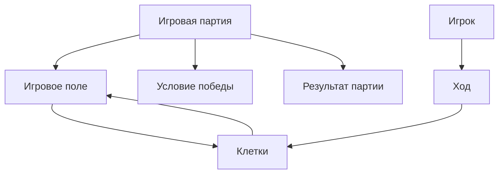
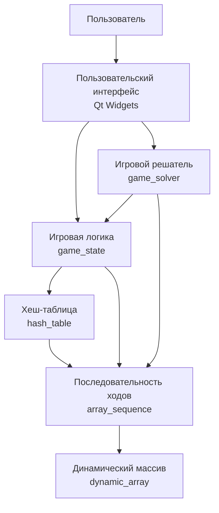

# Крестики-нолики с компьютерным соперником

## 1. Постановка задачи

### 1.1. Идея и концепция

Программа представляет собой настольную игру «Крестики-нолики», в которой пользователь играет против компьютера. Игровое поле имеет настраиваемый размер, а для победы необходимо собрать заданное количество одинаковых знаков в непрерывную линию.

Пользователь играет крестиками (`X`), компьютер — ноликами (`O`). Первым ходит пользователь. После каждого хода пользователя программа автоматически рассчитывает и выполняет ответный ход компьютера, если партия ещё не завершена.

### 1.2. Назначение программы

Программа предназначена для организации партии в пошаговую игру с двумя соперниками, общей игровой доской и заранее определённым условием победы.

Задача относится к классу детерминированных игр с полной информацией: оба участника видят всё игровое поле, а результат каждого хода однозначно определяется текущей позицией и выбранной клеткой. Для выбора действий компьютер использует поиск по возможным продолжениям партии.

---

## 2. Сущности прикладной задачи

### 2.1. Сущности и их описание

| Сущность | Описание |
|---|---|
| **Игровая партия** | Отдельная игра, в которой заданы размер поля и длина линии, необходимой для победы. Партия хранит текущее состояние поля и свой результат. |
| **Игрок** | Участник партии. В текущей версии предусмотрены пользователь (`X`) и компьютер (`O`). |
| **Игровое поле** | Квадратная сетка размером `N × N`, на которой участники размещают свои знаки. |
| **Клетка** | Позиция на поле, определяемая строкой и столбцом. Может быть пустой либо содержать `X` или `O`. |
| **Ход** | Выбор игроком одной свободной клетки для размещения своего знака. |
| **Условие победы** | Количество одинаковых знаков, которые необходимо выстроить подряд по горизонтали, вертикали или диагонали. |
| **Результат партии** | Одно из состояний: игра продолжается, победил `X`, победил `O` или зафиксирована ничья. |

### 2.2. Связи между сущностями

- Игровая партия содержит одно игровое поле и задаёт условие победы.
- Игровое поле состоит из клеток.
- Игрок совершает ход, выбирая свободную клетку.
- Ход изменяет состояние выбранной клетки: пустая клетка получает знак текущего игрока.
- Последовательность ходов определяет текущее состояние партии.
- Результат партии определяется состоянием поля и условием победы.

---

## 3. Архитектура

### 3.1. Высокоуровневые компоненты

Система разделена на пользовательский интерфейс, компонент управления игровым состоянием, компонент выбора хода компьютера и вспомогательные структуры данных.

| Компонент | Назначение |
|---|---|
| **Пользовательский интерфейс** | Отображает поле и элементы управления, принимает действия пользователя, передаёт их игровой логике и показывает обновлённое состояние партии. Реализован средствами Qt Widgets. |
| **Игровая логика** | Хранит состояние партии, определяет текущего игрока, проверяет допустимость ходов, определяет победу или ничью и предоставляет список свободных клеток. |
| **Игровой решатель** | Формирует множество рассматриваемых ходов компьютера, оценивает игровые позиции и выбирает ход с помощью алгоритма Minimax с альфа-бета-отсечением. |
| **Компонент структур данных** | Предоставляет используемые программой последовательности и хеш-таблицу. Хеш-таблица служит основным хранилищем занятых клеток игрового поля. |

### 3.2. Связи между компонентами

Пользователь взаимодействует с программой только через интерфейс. Интерфейс передаёт выбранный ход игровой логике, а после хода пользователя обращается к решателю за ответным ходом компьютера. Решатель анализирует позиции через интерфейс игрового состояния и не изменяет исходную позицию напрямую.

### 3.3. Алгоритмы, структуры данных и принятые решения

#### Игровое состояние

Игровое состояние описывает размер поля, длину выигрышной линии, расположение знаков и результат партии.

Для хранения занятых клеток используется хеш-таблица, в которой ключом является линейный индекс клетки, а значением — её знак. Индекс вычисляется по координатам клетки: `строка × размер поля + столбец`. Пустые клетки отдельно не хранятся: отсутствие соответствующего ключа означает, что клетка свободна.

Такое представление позволяет хранить только занятые клетки, что соответствует разреженному характеру игрового поля в начале партии. Хеш-таблица используется именно как хранилище игрового поля; кэширование результатов Minimax в текущей версии не применяется.

Игровое состояние проверяет корректность исходной позиции: размеры поля и выигрышной линии, допустимые значения клеток, индексы клеток и соотношение количества крестиков и ноликов. Также исключаются позиции, в которых одновременно победили оба игрока или победитель не соответствует очередности ходов.

Ход формирует новое игровое состояние на основе предыдущего. Исходное состояние не изменяется. После размещения знака заново определяется результат партии.

#### Определение результата партии

Для каждой занятой клетки проверяются четыре направления:

- горизонтальное;
- вертикальное;
- диагональ сверху слева вниз направо;
- диагональ сверху справа вниз налево.

Если от клетки начинается непрерывная последовательность знаков одного игрока длиной, равной заданному условию победы, этот игрок объявляется победителем. Если выигрышной линии нет, но свободных клеток больше не осталось, партия заканчивается ничьей. В остальных случаях игра продолжается.

#### Выбор хода компьютером

Для выбора хода используется Minimax. Компьютер рассматривает себя как максимизирующую сторону: положительная оценка выгодна `O`. Пользователь рассматривается как минимизирующая сторона: он стремится уменьшить оценку позиции.

Алгоритм строит дерево возможных продолжений партии на ограниченную глубину. В каждой вершине рассматриваются доступные ходы текущего игрока:

- на ходе компьютера выбирается продолжение с наибольшей оценкой;
- на ходе пользователя выбирается продолжение с наименьшей оценкой.

Поиск ограничен тремя полуходами с учётом первоначального рассматриваемого хода компьютера. Если на достигнутой глубине партия ещё не завершена, положение оценивается эвристически.

Для оценки используются следующие значения:

- победа компьютера — положительная большая оценка;
- победа пользователя — отрицательная большая оценка;
- ничья — нулевая оценка.

Для незавершённой партии анализируются возможные выигрышные линии длиной `K`. Линия, в которой уже присутствуют знаки обоих игроков, не влияет на оценку. Линия, содержащая знаки только одного игрока, добавляет или вычитает вес, зависящий от количества его знаков: `K` в степени количества знаков. Поэтому продвижение к завершению собственной линии повышает оценку, а создание потенциальных линий соперника снижает её.

При обнаружении завершённой партии учитывается глубина, на которой она завершилась: алгоритм предпочитает более быструю победу компьютера и более позднее поражение.

Для сокращения перебора применяется альфа-бета-отсечение. Оно позволяет прекращать рассмотрение ветви, если уже известно, что её результат не может повлиять на выбор хода относительно найденных альтернатив.

Перед поиском множество возможных ходов дополнительно сокращается: на пустом поле рассматриваются центральные клетки, а в ходе партии — свободные клетки в окрестности уже занятых. Если такой фильтр не оставляет кандидатов, используются все доступные ходы. Это уменьшает размер дерева поиска, но вместе с ограниченной глубиной означает, что решатель не гарантирует нахождение глобально оптимального хода во всех возможных позициях.

#### Структуры данных

- **`hash_table`** — ассоциативная структура, используемая для хранения занятых клеток игрового поля по их индексам.
- **`array_sequence`** — последовательность, используемая, в частности, для представления списка доступных и рассматриваемых ходов.
- **`dynamic_array`** — динамический массив, лежащий в основе последовательности.

---

## 4. Функциональные требования

### 4.1. Требования к настройке партии

**FR-1.** Программа должна позволять выбрать размер квадратного игрового поля от `3 × 3` до `10 × 10`.

**FR-2.** Программа должна позволять выбрать длину выигрышной линии от 3 до 5 клеток, но не больше размера поля. Для поля меньше 5 клеток максимальная длина линии равна размеру поля.

**FR-3.** По нажатию кнопки начала игры программа должна создавать новую пустую партию с выбранными параметрами.

### 4.2. Требования к игровому процессу

**FR-4.** Первым ходит пользователь, размещающий крестики (`X`).

**FR-5.** Пользователь должен иметь возможность выбрать любую свободную клетку игрового поля.

**FR-6.** После хода пользователя компьютер должен автоматически выполнить ответный ход ноликами (`O`), если партия не завершилась.

**FR-7.** После каждого хода программа должна обновлять отображение игрового поля и определять, продолжается ли партия.

**FR-8.** Программа должна определять победу при образовании непрерывной линии заданной длины по горизонтали, вертикали или диагонали.

**FR-9.** Программа должна определять ничью, если свободных клеток не осталось и ни один игрок не выполнил условие победы.

**FR-10.** Программа не должна допускать повторное занятие клетки, выход за границы поля или совершение хода после завершения партии.

**FR-11.** Компьютер должен выбирать ход с использованием Minimax, эвристической оценки позиции и альфа-бета-отсечения.

### 4.3. Требования к пользовательскому интерфейсу

**FR-12.** Интерфейс должен отображать игровое поле в виде сетки, соответствующей выбранному размеру.

**FR-13.** Знаки игроков должны визуально различаться: крестики отображаются синим цветом, нолики — красным.

**FR-14.** Во время партии занятые клетки не должны принимать пользовательские нажатия.

**FR-15.** После победы или ничьей программа должна завершать игровой процесс, блокировать дальнейшие ходы и возвращать пользователю панель настройки новой партии.

**FR-16.** Программа должна предоставлять возможность закрыть приложение через элемент управления выхода.

### 4.4. Особые сценарии

- **Пользователь выигрывает своим ходом.** Ответный ход компьютера не выполняется; партия завершается.
- **Компьютер выигрывает своим ходом.** Партия завершается сразу после обновления состояния поля.
- **Свободных клеток не осталось.** Если выигрышной линии нет, фиксируется ничья.
- **Попытка некорректного хода.** Игровая логика отклоняет ход, если клетка занята, координаты выходят за пределы поля или партия уже завершена.
- **Создание позиции из готового набора клеток.** Игровая логика проверяет корректность такой позиции до определения её результата.

---

## 5. Ограничения текущей версии

- Игра рассчитана на одного пользователя и одного компьютерного соперника.
- Пользователь всегда играет за `X`, компьютер — за `O`; выбор знака и первого игрока не предусмотрен.
- Глубина поиска компьютера фиксирована и равна трём полуходам.
- Множество рассматриваемых ходов сокращается эвристическим фильтром соседних клеток. Поэтому компьютер может не находить лучший ход в глобальном смысле.
- Сохранение и загрузка партий, отмена ходов, сетевой режим и настройка сложности не входят в текущий функционал.
